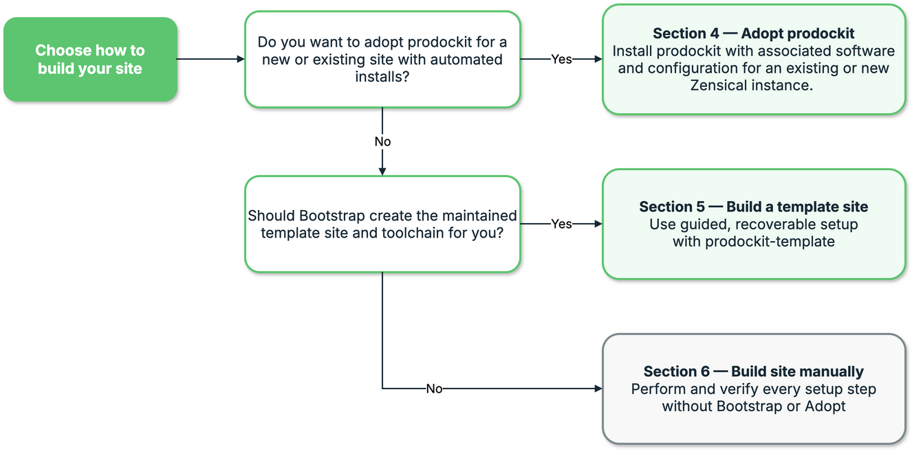

{{ pdk_heading_counter_reset(page) }}

# Choose your install

Start with [section 2.1, A basic Prodockit install](#install-prodockit), if
Python and Zensical are already installed and you have a working Zensical
site. [Section 2.2](#choose-an-installation-path) covers three detailed
routes that explain how to set up the prerequisites and install Prodockit
for different projects.

## A basic Prodockit install {: #install-prodockit }

Before you start, check that:

1. Python 3.14 is installed.
2. Zensical is installed in your project's virtual environment, and that
   environment is active.
3. Your Zensical site has been initialised and builds successfully.

If you only need to create the Zensical site, follow
[Zensical's Get started guide](https://zensical.org/docs/get-started/){target="_blank" rel="noopener"}
first. For help setting up your machine, repository or project, choose a
detailed route in [section 2.2](#choose-an-installation-path).

/// steps

//// step | Install Prodockit

With the Zensical project's environment active, install Prodockit.

```bash
python -m pip install --upgrade prodockit
```

////

//// step | Enable the Markdown extensions

Enable the Markdown extensions your site uses in `zensical.toml`. Add only
the tables you need. If a table already exists, edit it in place. Quote the
dotted Prodockit extension names as shown.

```toml
[project.markdown_extensions."prodockit.headings"]
[project.markdown_extensions."prodockit.refs"]
[project.markdown_extensions."prodockit.glossary"]
[project.markdown_extensions."prodockit.tables"]
[project.markdown_extensions."prodockit.steps"]
[project.markdown_extensions."prodockit.tree"]
[project.markdown_extensions."prodockit.index"]

[project.markdown_extensions."pymdownx.blocks.caption"]
types = [
  { name = "caption" },
  { name = "figure-caption", prefix = "{}.", classes = "prodockit-figure-caption" },
  { name = "table-caption", prefix = "{}.", classes = "prodockit-table-caption" },
]
```

Keep any existing caption types when adding the three shown above.
`prodockit.index` is for marking terms for a PDF index.

For hand-written references, enable
[`prodockit.citations`](extensions/citations.md#citations-enable). For
BibTeX or BibLaTeX, use [`prodockit.bibliography`](extensions/bibliography.md)
and configure a citation style.

////

//// step | Register the website stylesheet

Add `"stylesheets/pdk.css"` to `extra_css` in the existing `[project]`
table. Keep the other entries. If you have your own `extra.css`, list it
after `pdk.css` so it can override the default styles.

```toml
extra_css = ["stylesheets/pdk.css"]
```

Create `.prodockit-shared-files.toml` beside `zensical.toml`, or add the
missing entry to your existing manifest. Keep its existing version and entries.

```toml
version = 1

[[files]]
source = "pdk.css"
target = "docs/stylesheets/pdk.css"
```

////

//// step | Enable Prodockit macros **Optional**{: .bg-green}

If you use [Prodockit macros](macros.md#macros-quick-start), add
`"prodockit.zensical_macros"` to the existing Zensical macros `modules`
list. For a site without a macros table, use this configuration.

```toml
[project.markdown_extensions.zensical.extensions.macros]
modules = ["prodockit.zensical_macros"]
on_error_fail = true
```

////

//// step | Enable image hotspots **Optional**{: .bg-green}

[Image hotspots](extensions/image-hotspots.md#enable-image-hotspots) use a
SuperFences formatter. If you use hotspots, add this entry to the
`custom_fences` list, keeping other entries such as Mermaid.

```toml
[project.markdown_extensions.pymdownx.superfences]
custom_fences = [
  { name = "image-hotspots", class = "image-hotspots", format = "prodockit.image_hotspots.format_hotspots" },
]
```

////

//// step | Register JavaScript for carousels or festive effects **Optional**{: .bg-green}

If you plan to use [card carousels](extensions/carousel.md#enable-the-carousel)
or the [festive overlay](extensions/festive.md#enable-the-festive-extension),
add `"javascripts/pdk.js"` to `extra_javascript` in the existing `[project]`
table. Keep any other entries.

```toml
extra_javascript = ["javascripts/pdk.js"]
```

Add this entry to `.prodockit-shared-files.toml` if it is missing.

```toml
[[files]]
source = "pdk.js"
target = "docs/javascripts/pdk.js"
```

For card carousels, also enable `[project.markdown_extensions.md_in_html]`
if it is missing. For the festive overlay, follow its setup guide after your
site builds. That guide includes the optional sleigh image.

////

//// step | Copy and check the website assets

From the folder containing `zensical.toml`, copy the files listed in the
manifest from your installed Prodockit package, then check them.

```bash
pdk shared-files --apply
pdk shared-files --check
```

Rerun these commands after upgrading Prodockit or editing the manifest.

////

//// step | Prepare local PDF support **Optional**{: .bg-green}

For optional local PDF generation, run the block for the current platform.
Skip this on Windows ARM64 and let the GitLab pipeline generate PDFs instead.
`pdk pdf --prepare all` creates and registers the PDF stylesheets **before**
preparing the renderer; an ordinary `pdk pdf` does the same before rendering.
Do not add `[project.markdown_extensions."prodockit.pdf"]` to `zensical.toml`:
`prodockit.pdf` is the PDF command's renderer, not a Markdown extension.

=== ":material-apple: macOS"

    ```bash
    brew install pango node
    export DYLD_FALLBACK_LIBRARY_PATH="$(brew --prefix)/lib"
    pdk pdf --prepare all
    ```

=== ":fontawesome-brands-windows: Windows x64"

    ```powershell
    winget install OpenJS.NodeJS.LTS
    # Close and reopen PowerShell, then reactivate the project environment.
    pdk pdf --prepare all
    ```

=== ":material-linux: Linux (Ubuntu)"

    ```bash
    sudo apt update
    sudo apt install -y libpango-1.0-0 libpangoft2-1.0-0 libharfbuzz-subset0 nodejs
    pdk pdf --prepare all
    ```

On first use, `pdk pdf --prepare all` makes these changes:

- Creates `pdk-pdf.toml` and `pdf-requirements.txt` if missing. It also adds
  `docs/stylesheets/pdk-pdf.css` and an empty `docs/stylesheets/print.css` if
  missing, then lists both under `[document].extra_css` in `pdk-pdf.toml`.
  Existing PDF stylesheets are not overwritten; `zensical.toml` is unchanged
  for a new project.
- Installs the PDF-only Python packages in the active project environment and
  downloads the PDF tools into the project's `.prodockit/cache/pdf/` directory.
  A later run reuses the prepared files and cache when they are current.

`--prepare all` does not build a PDF or install host software such as Pango
or Node.js; the platform command above installs those prerequisites. Review
the project-file changes with `git status` before committing them.

////

//// step | Build and preview

Build and preview the site whenever its content changes:

```bash
zensical build --clean --strict
pdk pdf       # optional if PDF generation is used
zensical serve
```

////

///

## Detailed installation routes {: #choose-an-installation-path }

Choose one route based on your starting point and how much setup you want
Prodockit to handle. Start with the shared prerequisites in section 3,
[Prepare to install](installation.md). Your chosen route then
guides you through the project environment, installation and verification.


!!! info "Coursework with a prepared repository"

    If you are using Prodockit for coursework, your course will give you a
    prepared repository. Follow [section 5 — Build a template site](devcons/bootstrap.md)
    to set it up; you do not need to create a separate site from scratch.


\ref{fig-installation-approaches} helps you choose between a template site,
adopting Prodockit for a new or existing Zensical site, and a manual installation.

<!-- Adapted from prodockit-userguide. The canonical editable source for this figure is tools/documentation-diagrams/2.1-installation-approaches.drawio. -->
{ .documentation-diagram }
/// figure-caption
    attrs: {id: fig-installation-approaches}

Choose the Prodockit installation approach
///

The cards show what each route starts with and where to find its instructions.

<div class="grid cards installation-route-grid" markdown>

-   :lucide-puzzle:{ .lg .middle } __Adopt prodockit__

    ---

    **Starting point:** a new or existing Zensical site that will use its own
    structure.

    Create a new site or return to your existing project environment, then
    use Adoption (`pdk adopt`) to configure Prodockit and verify the site.

    [:octicons-arrow-right-24: Open section 4](getting-started.md){ .md-button .md-button--primary .installation-route-button }

-   :lucide-layout-template:{ .lg .middle } __Build a template site__

    ---

    **Starting point:** a project that should use the maintained report
    template, including a prepared coursework repository.

    Use `pdk boot` to guide the machine, Git, project environment and
    publishing setup. The project can receive updates from
    `prodockit-template`.

    [:octicons-arrow-right-24: Open section 5](devcons/bootstrap.md){ .md-button .md-button--primary .installation-route-button }

-   :lucide-hammer:{ .lg .middle } __Build site manually__

    ---

    **Starting point:** a project you want to set up and configure yourself.

    Follow the commands for the machine, repository, editor, Python
    environment and Zensical configuration. Build and verify the outputs
    you need.

    [:octicons-arrow-right-24: Open section 6](manual-install.md){ .md-button .md-button--primary .installation-route-button }

</div>
