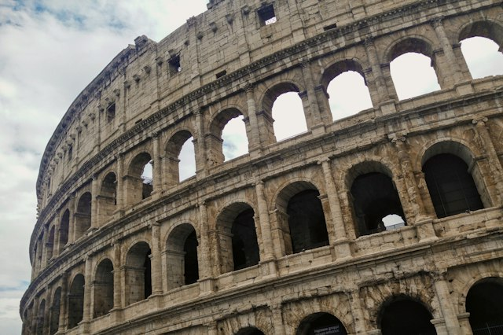
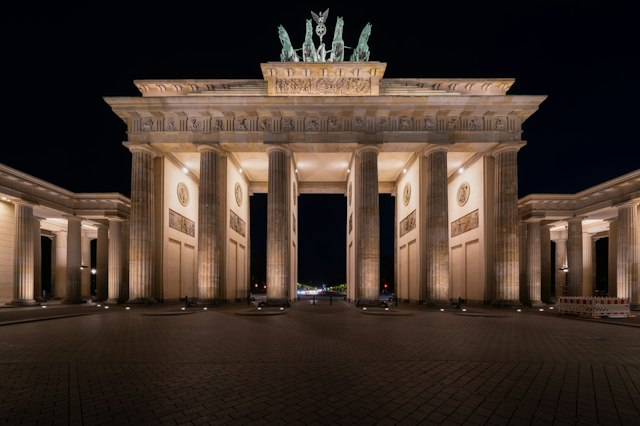
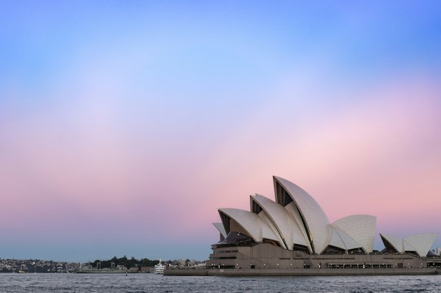
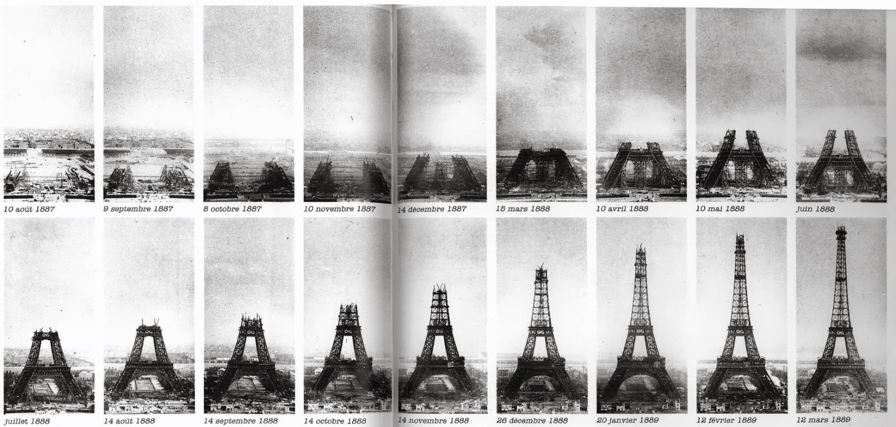

{{ pdk_heading_counter_reset(page) }}

# Card carousel

Turn an ordinary grid of cards into a responsive, infinitely wrapping carousel.
The carousel accepts **any number of cards**. Five cards arranged as three plus
two is just one example: the card count and the number visible at once are
independent.

## Enable the carousel

The carousel is a website extension in the managed `pdk.js` and `pdk.css`
assets. It does not need a Python-Markdown extension table. Projects prepared
with Adopt already load these assets. After upgrading Prodockit, refresh them:

```bash
pdk shared-files --apply
```

For a manually configured project, load the managed files in `zensical.toml`
and enable Markdown inside HTML containers:

```toml
[project]
extra_css = ["stylesheets/pdk.css"]
extra_javascript = ["javascripts/pdk.js"]

[project.markdown_extensions.md_in_html]
```

Keep any existing stylesheet, JavaScript and Markdown-extension settings when
adding these entries. The files ship in the Prodockit wheel and use the existing
shared-file manifest and adoption mechanisms; there is no carousel library or
runtime CDN dependency. Existing template projects receive them through their
normal package upgrade and `pdk shared-files --apply` workflow.

## Write the Markdown

Add `pdk-carousel` to an existing `grid cards` container and give it a meaningful
accessible name. Its direct list items become the carousel sequence in source
order, regardless of how many grid rows they originally occupied.

```html
<div class="grid cards pdk-carousel pdk-carousel-tiles" markdown data-carousel-label="Featured resources">

-   __Explore__

    Find your starting point.

    [Read the overview](../authoring.md)

-   __Write__

    Structure your document with clear headings. Give each section a meaningful
    title so readers can find the information they need.

    [Use headings](headings.md)

-   __Connect__

    Link to sections, figures and tables.

    [Add cross-references](refs.md)

-   __Reference__

    Cite your sources consistently.

    [Use a bibliography](bibliography.md)

-   __Publish__

    Share your work online and in print.

    [Generate a PDF](../pdf.md)

</div>
```

### Live example: five cards

!!! tip "View the Markdown"
    To view the Markdown for this page, click the :material-eye: **eye icon**
    at the top right of the page.

Use the small **left and right arrow buttons** at the bottom of the cards, drag a card body with the mouse,
or focus an arrow button and press the left or right arrow key. The sequence wraps in both directions. On touchscreens,
swipe horizontally over the card body; links and form controls retain their
normal interaction.

<div class="grid cards pdk-carousel pdk-carousel-tiles" markdown data-carousel-label="Featured resources">

-   __Explore__

    Find your starting point.

    [Read the overview](../authoring.md)

-   __Write__

    Structure your document with clear headings. Give each section a meaningful
    title so readers can find the information they need.

    [Use headings](headings.md)

-   __Connect__

    Link to sections, figures and tables.

    [Add cross-references](refs.md)

-   __Reference__

    Cite your sources consistently.

    [Use a bibliography](bibliography.md)

-   __Publish__

    Share your work online and in print.

    [Generate a PDF](../pdf.md)

</div>

### Live example: countries, three cards wide

Choose a photograph or country name to open that country in Wikipedia. This
six-card carousel shows three equal-height image tiles on a desktop page and
fewer on narrow screens. The photos are local 640 × 426 pixel JPEGs, cropped to
a consistent landscape shape, with photographer credits below each tile. The photos fill each card edge to
edge, with an 8-pixel gap between neighbouring cards.

<div class="grid cards pdk-carousel pdk-carousel-tiles" markdown data-carousel-label="Explore countries" data-carousel-visible="3" data-carousel-min-width="160" data-carousel-gap="8" data-carousel-image-fill="true" data-carousel-position="false">

-   [{ .pdk-carousel-image width="640" height="426" loading="lazy" }](https://en.wikipedia.org/wiki/United_Kingdom)

    [__United Kingdom__](https://en.wikipedia.org/wiki/United_Kingdom)

    <small>Photo: [enrico bet](https://unsplash.com/photos/big-ben-london-MdJq0zFUwrw) / Unsplash</small>

-   [{ .pdk-carousel-image width="640" height="426" loading="lazy" }](https://en.wikipedia.org/wiki/France)

    [__France__](https://en.wikipedia.org/wiki/France)

    <small>Photo: [Chris Karidis](https://unsplash.com/photos/eiffel-tower-paris-france-nnzkZNYWHaU) / Unsplash</small>

-   [{ .pdk-carousel-image width="640" height="426" loading="lazy" }](https://en.wikipedia.org/wiki/Italy)

    [__Italy__](https://en.wikipedia.org/wiki/Italy)

    <small>Photo: [Sarah Doffman](https://unsplash.com/photos/colosseum-rome-TC73XlNiDeM) / Unsplash</small>

-   [{ .pdk-carousel-image width="640" height="426" loading="lazy" }](https://en.wikipedia.org/wiki/Japan)

    [__Japan__](https://en.wikipedia.org/wiki/Japan)

    <small>Photo: [Bryan Heng](https://unsplash.com/photos/mount-fuji-above-lake-in-japan-J8HzbBdqdV0) / Unsplash</small>

-   [{ .pdk-carousel-image width="640" height="426" loading="lazy" }](https://en.wikipedia.org/wiki/Germany)

    [__Germany__](https://en.wikipedia.org/wiki/Germany)

    <small>Photo: [Claudio Schwarz](https://unsplash.com/photos/brandenburg-gate-berlin-cQ41AMy31Zw) / Unsplash</small>

-   [{ .pdk-carousel-image width="640" height="426" loading="lazy" }](https://en.wikipedia.org/wiki/Australia)

    [__Australia__](https://en.wikipedia.org/wiki/Australia)

    <small>Photo: [Johnny Bhalla](https://unsplash.com/photos/sydney-opera-house-DLbCETd599Y) / Unsplash</small>

</div>

Use `data-carousel-visible="3" data-carousel-min-width="160"` for this compact
three-card layout. Add `data-carousel-image-fill="true" data-carousel-gap="8"`
for edge-to-edge photos and a small gap. Add the `pdk-carousel-image` class to card images to keep
their displayed dimensions consistent. The `pdk-carousel-tiles` class keeps
these short picture cards together on a printed page. The picture and country-name links
remain usable, while dragging a picture or the card body moves the carousel.

### Live example: automatic rotation

This separate seven-card example shows half-card previews on both edges and
slides smoothly to the next card every four seconds. Hovering over it,
focusing any of its content, or hiding the browser tab pauses rotation. Use
**P** while a carousel arrow has focus to keep it paused after leaving. The
pause button is hidden in this example with `data-carousel-pause="false"`;
omit that option to show the pause/resume button.
Reduced-motion preferences disable automatic rotation and transitions.
The cards progress from white to dark grey; the four darkest cards use white
text to maintain readable contrast.

<div class="grid cards pdk-carousel pdk-carousel-tiles weekly-contrast" markdown data-carousel-label="Weekly ideas" data-carousel-visible="2" data-carousel-peek="true" data-carousel-position="false" data-carousel-pause="false" data-carousel-autoplay="true" data-carousel-interval="4000">

<ul>
<li style="--weekly-card-bg: #ffffff; --weekly-card-text: #000000;"><p><strong>Monday</strong></p><p>Choose a topic.</p></li>
<li style="--weekly-card-bg: #dddddd; --weekly-card-text: #000000;"><p><strong>Tuesday</strong></p><p>Gather evidence.</p></li>
<li style="--weekly-card-bg: #bbbbbb; --weekly-card-text: #000000;"><p><strong>Wednesday</strong></p><p>Make an outline.</p></li>
<li style="--weekly-card-bg: #747474; --weekly-card-text: #ffffff;"><p><strong>Thursday</strong></p><p>Write a first draft.</p></li>
<li style="--weekly-card-bg: #626262; --weekly-card-text: #ffffff;"><p><strong>Friday</strong></p><p>Review the argument.</p></li>
<li style="--weekly-card-bg: #4a4a4a; --weekly-card-text: #ffffff;"><p><strong>Saturday</strong></p><p>Check the references.</p></li>
<li style="--weekly-card-bg: #333333; --weekly-card-text: #ffffff;"><p><strong>Sunday</strong></p><p>Publish and share.</p></li>
</ul>

</div>

Keyboard arrows apply only to the carousel region and its controls, so links,
text inputs and other card content keep their normal keyboard behaviour.
Offscreen cards and decorative previews are hidden from the accessibility tree
and keyboard focus.
Manual navigation announces the visible card numbers; autoplay does not
repeatedly interrupt screen-reader users. The visible count and list of card
numbers appear below the cards unless `data-carousel-position="false"`.

### Live example: numbered cards without wrapping

Follow the Eiffel Tower construction through 18 dated photographs, from
10 August 1887 to 12 March 1889. Each card has a top-right badge from `1/18`
to `18/18`. Use the arrows or drag to move through the sequence; navigation
stops at the first and last window. Six equal-height cards appear on wide
screens, with an 8-pixel gap and fewer cards on narrow screens.

<div class="grid cards pdk-carousel pdk-carousel-tiles eiffel-construction" markdown data-carousel-label="Eiffel Tower construction" data-carousel-badges="true" data-carousel-badge-corner="top-right" data-carousel-loop="false" style="--pdk-carousel-badge-color: #fff; --pdk-carousel-badge-bg: rgba(0, 0, 0, 0.75);" data-carousel-visible="6" data-carousel-min-width="80" data-carousel-gap="8" data-carousel-image-fill="true" data-carousel-position="false">

-   <span class="eiffel-construction-stage"></span>

    __10 August 1887__

-   <span class="eiffel-construction-stage"></span>

    __9 September 1887__

-   <span class="eiffel-construction-stage"></span>

    __8 October 1887__

-   <span class="eiffel-construction-stage"></span>

    __10 November 1887__

-   <span class="eiffel-construction-stage"></span>

    __14 December 1887__

-   <span class="eiffel-construction-stage"></span>

    __15 March 1888__

-   <span class="eiffel-construction-stage"></span>

    __10 April 1888__

-   <span class="eiffel-construction-stage"></span>

    __10 May 1888__

-   <span class="eiffel-construction-stage"></span>

    __June 1888__

-   <span class="eiffel-construction-stage"></span>

    __July 1888__

-   <span class="eiffel-construction-stage"></span>

    __14 August 1888__

-   <span class="eiffel-construction-stage"></span>

    __14 September 1888__

-   <span class="eiffel-construction-stage"></span>

    __14 October 1888__

-   <span class="eiffel-construction-stage"></span>

    __14 November 1888__

-   <span class="eiffel-construction-stage"></span>

    __26 December 1888__

-   <span class="eiffel-construction-stage"></span>

    __20 January 1889__

-   <span class="eiffel-construction-stage"></span>

    __12 February 1889__

-   <span class="eiffel-construction-stage"></span>

    __12 March 1889__

</div>

Source: supplied PublicDomainArchive montage; dates follow the original
captions. [View the complete construction sequence](../assets/carousel/eiffel-construction.jpg).

Enable badges with `data-carousel-badges="true"`. Choose any of
`top-left`, `top-right`, `bottom-left` or `bottom-right` with
`data-carousel-badge-corner`; an omitted or invalid corner uses `top-right`.
Each badge keeps its original card number as the carousel moves. Badges are
independent of the optional position label below the carousel.

Set `data-carousel-loop="false"` to stop wrapping. This differs from
`data-carousel-autoplay="false"`, which turns off automatic advancement.
You can combine finite navigation with autoplay; rotation stops at the final
window. Navigating back allows automatic advancement again unless paused.
With half-card previews enabled, the first and last windows leave the missing
neighbour's side empty instead of repeating a card.

Override the badge styles in `stylesheets/extra.css`, or set them on an
individual carousel as above:

```css
.pdk-carousel {
  --pdk-carousel-badge-color: #ffffff;
  --pdk-carousel-badge-bg: rgba(0, 0, 0, 0.75);
  --pdk-carousel-badge-inset: 0.5rem;
  --pdk-carousel-badge-padding: 0.15rem 0.45rem;
  --pdk-carousel-badge-font-size: 0.75rem;
  --pdk-carousel-badge-radius: 1rem;
}
```

Bottom badges sit above the arrow-control row. Choose text and background
colours that remain legible over your pictures.
Badges do not receive focus or intercept clicks and dragging; assistive
technology uses each slide's existing position label. Badges are hidden in
browser print and absent from generated PDFs, which retain every original
card once in source order. Without JavaScript, cards remain a static grid.

## Configure only when needed

Use \ref{tab-carousel-options} to set a carousel's accessible name, visible
card count and optional automatic rotation.

| Attribute | Default | Behaviour |
|---|---|---|
| `data-carousel-label` | `Cards` | Accessible name; use a descriptive name for each carousel. An existing `aria-label` or `aria-labelledby` takes precedence. |
| `data-carousel-visible` | `3` | Maximum visible cards, a positive integer. Narrow containers show fewer cards, aiming for at least 224 pixels per card. The total number of cards has no fixed limit. |
| `data-carousel-gap` | `16` | Space between cards in pixels, from 0 to 64. Use `8` for a small gap between picture tiles. |
| `data-carousel-image-fill` | `false` | Set to `true` for photos that fill each card edge to edge; titles and credits retain their own inset. |
| `data-carousel-min-width` | `224` | Preferred minimum card width in pixels, at least 80. Use `160` for compact three-wide picture tiles. Narrower viewports can still shrink the final single card. |
| `data-carousel-badges` | `false` | Set to `true` for an `index/total` badge on each card. |
| `data-carousel-badge-corner` | `top-right` | Badge placement: `top-left`, `top-right`, `bottom-left` or `bottom-right`. |
| `data-carousel-loop` | `true` | Set to `false` to stop at each end. Finite autoplay stops at the final window. |
| `data-carousel-position` | `true` | Set to `false` to hide the visible “Cards 1, 2 of 5” label. Accessible position announcements for manual navigation remain available. |
| `data-carousel-peek` | `false` | Set to `true` to show half of the neighbouring card on each edge. Preview cards are decorative; use an arrow or drag to bring them into view. |
| `data-carousel-duration` | `600` | Sliding duration in milliseconds, from 0 (instant) to 2000. Automatic rotation uses the same smooth transition across the loop boundary. |
| `data-carousel-pause` | `true` | Set to `false` to hide the pause/resume button when automatic rotation is enabled. Press **P** while an arrow has focus to pause or resume. |
| `data-carousel-autoplay` | `false` | Set to `true` for automatic advancement. Infinite wrapping also works without autoplay. |
| `data-carousel-interval` | `5000` | Milliseconds between automatic advances; values below 1000 are clamped to 1000. Invalid values use 5000. |
/// table-caption | <
    attrs: {id: tab-carousel-options}

Carousel options
///

Each carousel has independent controls and state. Empty grids remain unchanged;
when all cards fit, navigation and automatic rotation are disabled. All cards have the same height, measured from the tallest original card at the
current width, so the carousel stays steady as it moves. The smooth sliding
transition also works at the loop boundary. Decorative edge copies are inert,
hidden from assistive technology and excluded from print; their IDs and local
references are remapped to avoid duplicates. Original card DOM order stays unchanged.

## Print and PDF

Without JavaScript, or in browsers lacking the required enhancement APIs, the
complete ordinary grid remains available. Browser print shows every original
card once in source order and removes carousel controls, clipping and animation,
even after the carousel has advanced.

`pdk pdf` consumes the static card HTML without running JavaScript. It prints
all original cards in rows matching the authored visible-card count:
`data-carousel-visible="2"` prints two across, and `"3"` prints three across
(the default). Partial final rows retain their column widths. Browser print
uses the number of full cards currently visible on screen; decorative half-card
previews do not add columns. Long cards may continue onto another page.
Ordinary grid cards keep their existing PDF layout.

## Style the arrow buttons

Add overrides to `docs/stylesheets/extra.css` to change the small translucent
grey buttons and black arrows at the bottom corners of the cards. Scope the selector to a particular carousel class
when different carousels need different styles.

```css
.pdk-carousel {
  --pdk-carousel-button-bg: rgba(238, 238, 238, 0.75);
  --pdk-carousel-button-color: #000000;
  --pdk-carousel-button-hover-bg: rgba(221, 221, 221, 0.9);
  --pdk-carousel-button-border: #cccccc;
  --pdk-carousel-button-size: 1.6rem;
  --pdk-carousel-button-radius: 0.2rem;
}
```
