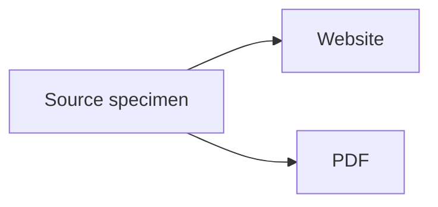

# Diagrams

Reference: [Zensical diagrams](https://zensical.org/docs/authoring/diagrams/)

## Mermaid flowchart {: #diagrams }

### Source

````md

````

### Rendered result


Zensical initializes Mermaid for the website. Prodockit replaces the Mermaid
source with a static vector diagram in the PDF, so no raw diagram syntax may
remain in the review document.
